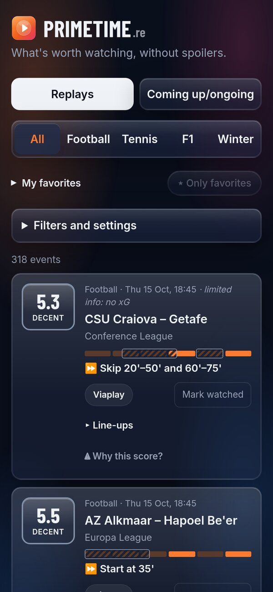
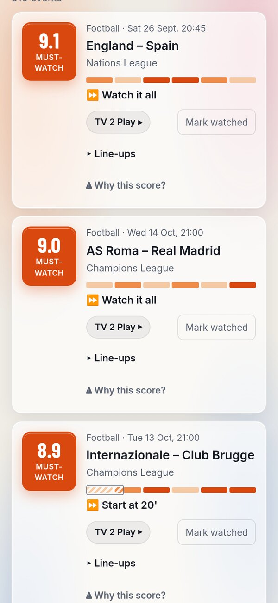
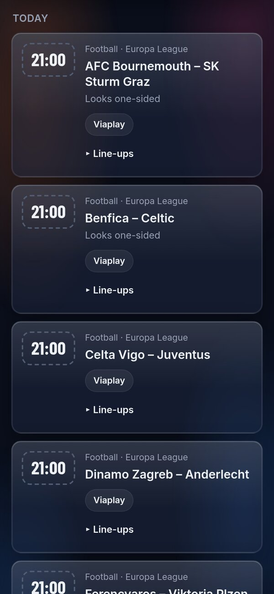
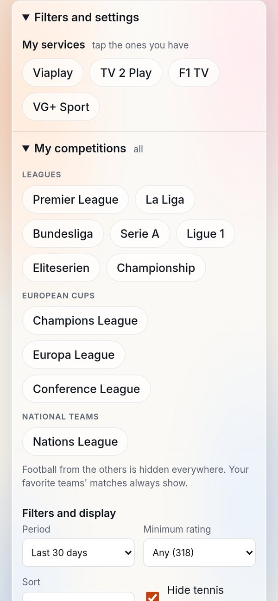

# PrimeTime

**What's worth watching, without spoilers.**

✓ 100% free · ✓ No ads · ✓ No tracking · ✓ No account

👉 **https://primetime.re**

<table>
  <tr>
    <td></td>
    <td></td>
    <td></td>
    <td></td>
  </tr>
  <tr>
    <td align="center">Replays</td>
    <td align="center">Best first</td>
    <td align="center">Coming up</td>
    <td align="center">Your services and competitions</td>
  </tr>
</table>

PrimeTime rates finished football matches, tennis Grand Slam matches, F1 races and winter sports (biathlon, alpine, cross-country) from 0 to 10 for how exciting they were, without ever showing a result. Each event gets:

- a **watchability score** and a label (Skip it / Decent / Good / Must-watch),
- a **skip tip**, like "Skip the first half", "Start from set 3" or "Watch the start, then skip to lap 30",
- a **heat strip** showing roughly where the action was,
- the **Norwegian streaming services** that show it (Viaplay, TV 2 Play, HBO Max, NRK TV, F1 TV, VG+ Sport).

**Football competitions:** the Premier League, La Liga, Bundesliga, Serie A, Ligue 1, Eliteserien and the Championship; the Champions League, Europa League and Conference League; and for national teams the Nations League, the EURO and World Cup qualifiers, the EURO and the World Cup.

Tap the services you have to see only what you can watch. Under Filters and settings → **My competitions** you pick the football competitions you follow; the others are hidden everywhere, except your favorite teams' matches. Tennis player names are hidden by default, because just seeing who reached a later round spoils earlier matches.

**Football scores have four pillars:** Chances, Tempo, Tension and Drama. Each gets a score from 0 to 10, and the match score is their weighted average (25% each), adjusted for the occasion (a big match, what was at stake). "Why this score?" (behind a spoiler warning) shows each pillar and the lines behind it. Under Filters and settings → Custom scoring you can weigh the pillars yourself, on your own device.

📖 **[How the scores work](HOW-IT-WORKS.md)**: what goes into each sport's score, the skip tips, and the rules that keep it spoiler-free.

You can install it on your phone's home screen like an app. Your settings stay on your device, and "Share my settings" moves them to another one with a link.

## Free, and staying that way

No ads, no tracking, no cookies, no account. There's no server: the page is a plain website on GitHub Pages, and your settings live only in your own browser. It updates itself every few minutes using free data from ESPN, FotMob, OpenF1, IBU and FIS, with no paid services and no API keys.

## Ideas and feedback

Got an idea? Use **Suggest an idea** at the bottom of the page, or [open a suggestion](https://github.com/dbugger85/PrimeTime/issues/new?template=suggestion.yml) here. Please don't write any results.

See [How the scores work](HOW-IT-WORKS.md) for the scoring, `CLAUDE.md` for the technical details, and `PLAN.md` for the decisions behind it.
